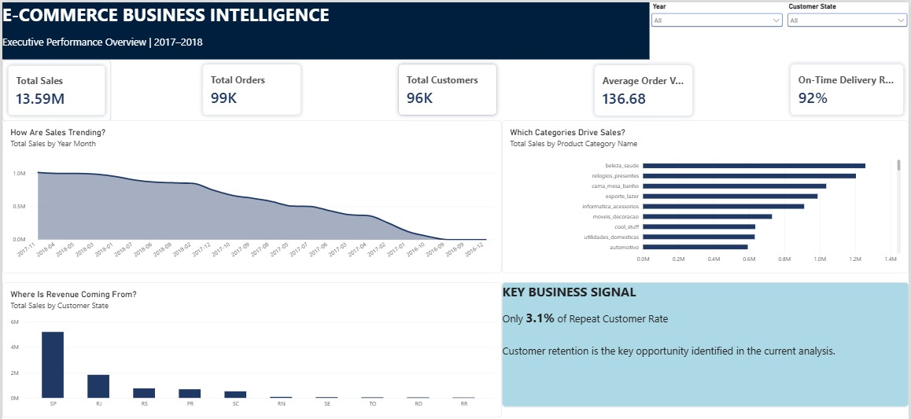
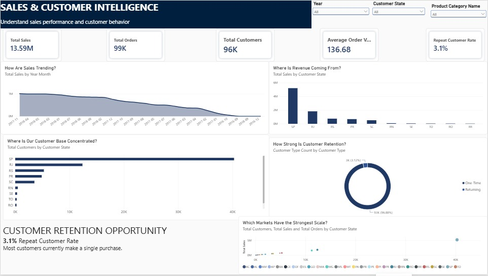
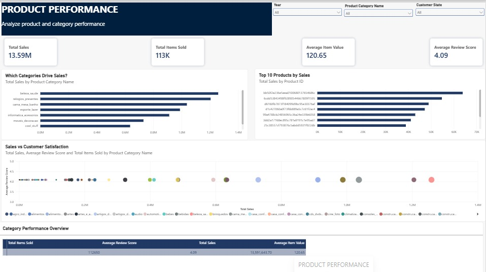
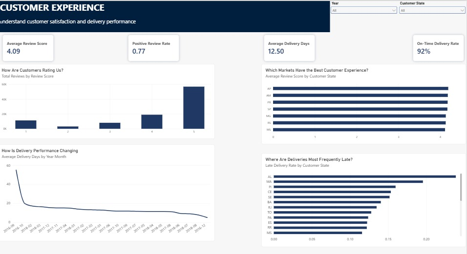
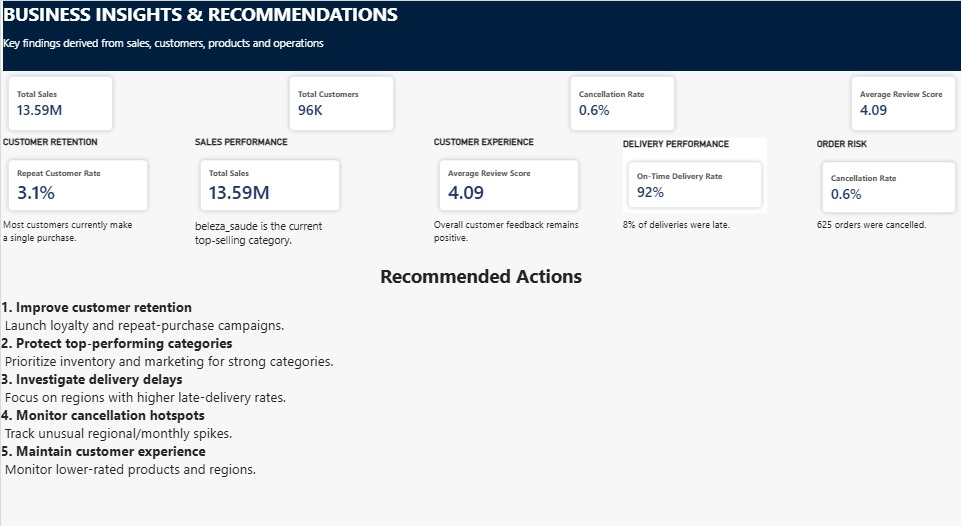
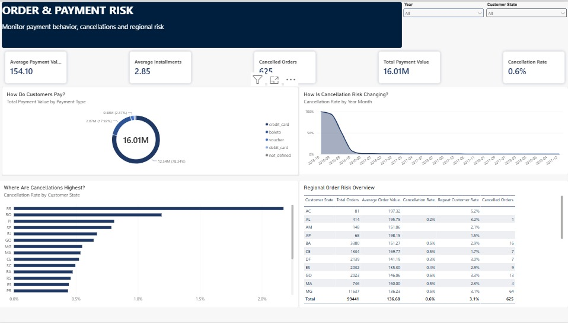

# E-Commerce Business Intelligence & Customer Analytics

> End-to-end Power BI project analyzing ~99K orders and ~96K customers across sales, customer behavior, products, delivery operations, payments, reviews, and order risk.

## Project Overview

This project uses the **Olist Brazilian E-Commerce dataset** to build a multi-page Power BI solution for management-level analysis. Raw relational data was cleaned and transformed with Power Query, modeled for reporting, and analyzed using DAX measures and interactive visualizations.

### Skills Demonstrated

`Power BI` · `Power Query` · `DAX` · `Data Modeling` · `Star Schema` · `KPI Design` · `Data Visualization` · `Business Intelligence`

## Executive Dashboard

## Business Questions

- How are sales and order volumes changing over time?
- Which categories and regions generate the most sales?
- What is the repeat-customer rate?
- How satisfied are customers?
- How efficient is delivery performance?
- Where are cancellations and payment risks concentrated?
- Which areas deserve management attention?

## KPI Snapshot

| KPI | Result |
|---|---:|
| Total Sales | 13.59M |
| Total Orders | 99K |
| Total Customers | 96K |
| Average Order Value | 136.68 |
| Repeat Customer Rate | 3.1% |
| Average Review Score | 4.09 / 5 |
| Average Delivery Time | 12.5 days |
| On-Time Delivery | 92% |
| Late Delivery | 8% |
| Cancelled Orders | 625 |
| Cancellation Rate | 0.6% |
| Total Payment Value | 16.01M |

## Data Preparation & Modeling

Using **Power Query**, I cleaned and transformed the source tables, standardized fields and data types, handled duplicate records, prepared date fields, and merged product-category translation data.

The reporting model connects customer, date, order, order-item, product, payment, and review data using one-to-many relationships to support cross-filtering and KPI analysis.

## Dashboard Pages

### 1. Executive Overview
High-level view of sales, orders, customers, AOV, and delivery performance.

### 2. Sales & Customer Intelligence
Sales trends, regional revenue, customer distribution, and repeat-purchase behavior.

### 3. Product Performance
Category/product performance across sales, item volume, value, and customer satisfaction.

### 4. Customer Performance
Customer behavior and experience metrics used to identify retention opportunities.

### 5. Business Insights & Recommendations
Management-oriented findings and recommended actions.

### 6. Order & Payment Risk
Payment behavior, cancellations, and regional order-risk analysis.

## Key Insights

- The repeat-customer rate is **3.1%**, indicating a meaningful retention opportunity.
- **92%** of orders were delivered on time; **8%** were late.
- **625** orders were cancelled, a **0.6%** cancellation rate.
- Average review score is **4.09/5**, showing generally positive customer feedback.
- `beleza_saude` was the highest-selling product category in the analysis.

## Recommendations

- Build loyalty and repeat-purchase campaigns to improve retention.
- Investigate regions with higher delivery delays.
- Protect and scale high-performing categories.
- Monitor cancellation hotspots by region and time.
- Track customer feedback alongside operational KPIs.

## Project Outcome

The project demonstrates an end-to-end BI workflow:

**Raw relational data → Power Query transformation → Data model → DAX KPIs → Interactive dashboards → Business recommendations**

It is designed to show not only Power BI visualization skills, but also the ability to structure analysis around real business questions and communicate findings clearly.

---
**Author:** Bindu Burla  
**Focus:** Data Analytics · Power BI · Business Intelligence
